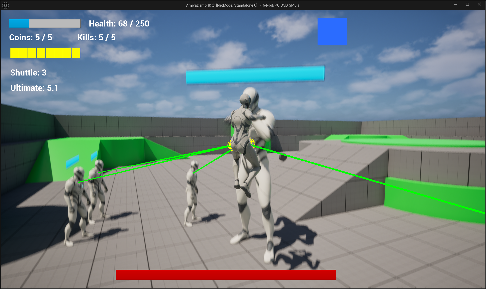

# AmiyaDemo

基于 Unreal Engine 5 和 C++ 开发的第三人称战斗 Demo。

项目以 UE 客户端开发学习和实习作品展示为目标，主要实现了角色战斗、技能系统、敌人 AI、Boss 战以及完整的关卡胜负流程。

目前已经可以完整游玩：

**普通战斗 → 完成金币 / 击杀目标 → Boss 出现 → 双阶段 Boss 战 → 胜利 / 失败**

---

## Demo

**72s Full Gameplay Demo**

普通战斗 → 格挡 / 防反 → 链式闪电 → 风驰电掣 → Boss Phase 1 → Time Deletion → Phase 2 → Victory

[▶ Watch Full Gameplay Demo](https://github.com/116275/AmiyaDemo/releases/tag/v1.0-demo)

---

## 操作说明

| 按键 | 操作 |
| --- | --- |
| `WASD` | 移动 |
| `Space` | 跳跃 |
| `Left Mouse Button` | 近战攻击 |
| `Left Shift` | 冲刺 |
| `Right Mouse Button` | 格挡 / 风驰电掣期间穿梭 |
| `R` | 链式闪电 / 再次按下确认释放 |
| `P` | 取消当前技能 |
| `E` | 技能强化 |
| `T` | 风驰电掣 |

> 推荐先通过击杀敌人与拾取金币积攒能量，再使用技能强化与终极技能挑战 Boss。

---

## Gameplay

### 基础战斗

玩家拥有普通近战攻击、生命值和自然回血机制。

敌人会主动寻找并攻击玩家，玩家需要在战斗的同时完成金币收集和敌人击杀目标。

完成目标后进入 Boss 战。

---

### 格挡与完美防反

玩家可以进行持续一段时间的格挡。

普通格挡可以降低受到的伤害。

在格挡开始后的短时间内受到攻击，则判定为完美防反：

- 本次伤害完全免疫
- 恢复额外能量
- 重置格挡冷却

因此玩家可以选择稳定防御，也可以承担更高风险尝试完美防反。

---

### 能量系统

玩家拥有独立的能量资源。

能量会随时间自然恢复，也可以通过击杀敌人和完美防反获得。

能量主要用于强化技能和释放终极技能。

---

### 链式闪电

玩家可以进入链式闪电瞄准状态并选择目标。

技能释放后会在敌人之间连续弹射。

根据当前技能强化状态，链式闪电会发生不同变化：

- Base：基础弹射，并存在伤害衰减
- Enhanced：增加弹射次数，并取消伤害衰减
- Overcharged：进一步增加弹射次数，并对命中的目标追加雷暴效果

链式闪电还会避开已经死亡或当前不可被选中的敌人。

---

### 终极技能：风驰电掣

消耗大量能量进入一段时间的强化状态。

强化期间：

- 提升移动能力
- 能量恢复加快
- 格挡输入会变为高速 Shuttle
- Shuttle 可以快速穿过敌人并造成路径伤害
- Shuttle 具有有限使用次数
- 技能结束时释放范围雷暴

该技能主要强化角色的机动性和短时间爆发能力。

---

## Boss

Boss 在完成普通关卡目标后生成。

Boss 拥有两个阶段。

### Phase 1

第一阶段主要能力：

- 近战攻击
- 周期性召唤 Minion
- 一段时间后吸收仍然存活的 Minion
- 吸收后恢复生命值
- 永久提高近战伤害
- 对麻痹效果具有一定抗性

玩家因此需要在输出 Boss 和处理 Minion 之间进行选择。

### Phase 2

第一阶段生命值耗尽后 Boss 进入第二阶段。

第二阶段：

- 获得新的生命值
- 移动和攻击更加激进
- 增加召唤数量
- 完全免疫麻痹
- 解锁 Time Deletion

### Time Deletion

Boss 会短暂进入“时间删除”状态。

期间整个世界被减速，而 Boss 自身保持正常行动速度。

Boss 同时会：

- 暂时消失
- 无法被技能选中
- 无法受到伤害
- 穿过玩家
- 继续接近玩家

状态结束后 Boss 会重新出现并尝试发动攻击。

---

## Technical Implementation

项目主要 Gameplay 逻辑使用 C++ 实现，并通过 Blueprint 和 UMG 完成动画、资源配置以及 UI 表现。

### Enemy AI

敌人使用自定义 AIController 控制追击和攻击。

目前主要包含：

**Chasing ↔ Attacking**

两个战斗状态。

不同敌人可以拥有不同的攻击距离、追击距离和攻击频率。

当玩家位于无法直接寻路到达的位置时，AI 会尝试在玩家附近寻找一个可以到达的位置，而不是直接停止移动。

### Combat

近战攻击使用 Animation Montage 播放攻击动画，并通过 Anim Notify 在指定动画时间点执行攻击判定。

攻击判定主要使用 Sphere Sweep。

### Boss

Boss 继承自普通 Enemy Character。

普通敌人与 Boss 共享一部分基础逻辑，而 Boss 可以覆盖自己的：

- 攻击距离
- 攻击频率
- 移动速度
- 麻痹抗性
- 是否可以被技能选中

这样避免为 Boss 重新复制一套完整敌人逻辑。

### HUD

HUD 显示：

- 玩家生命值
- 能量
- 技能冷却
- 终极技能持续时间
- Shuttle 次数
- Boss 血量
- 胜利 / 失败界面

Boss 是运行过程中动态生成的，因此 HUD 会在 Boss 出现时保存 Boss 引用并初始化对应 UI。

---

## Debugging

### AI 无法接近高台玩家

测试时发现，当玩家站在独立的高台区域时，Boss 和 Minion 会停止移动。

通过 Gameplay Debugger 和 Visual Studio Debugger 检查后发现：

`MoveToActor` 无法直接到达玩家，因此进入备用寻路逻辑；

随后进一步定位到 `ProjectPointToNavigation` 的垂直搜索范围不足，无法找到下方的可行走区域。

增大 Z 方向搜索范围后解决。

### Boss 吸收后异常回满

Boss 原本设计为每吸收一个 Minion 恢复一定比例生命值。

调试时发现 C++ 中数值为：

`0.18`

但运行时实际得到：

`18.0`

最终定位到 Blueprint 中保存了独立的属性值，覆盖了 C++ 默认值。

恢复正确的 Blueprint 默认值后解决。

### Boss 死亡后 HUD 报错

Boss 被销毁后，Boss 血条仍然尝试读取已经失效的 Boss 引用。

最终在 HUD 中增加引用有效性检查，避免访问已经进入销毁流程的 Actor。

---

## Tech Stack

Unreal Engine 5  
C++  
Blueprint  
UMG  
Enhanced Input  
AI / Navigation  
Animation Montage / Anim Notify  
Collision Query  
Delegate  
Timer

---

## Status

当前 Gameplay 功能已经完成并进入 Feature Freeze。

后续主要工作：

- Code Cleanup
- UI / Visual Polish